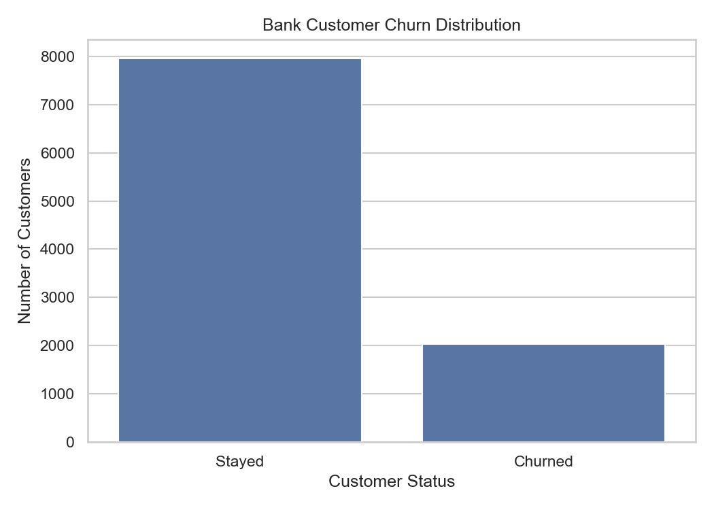
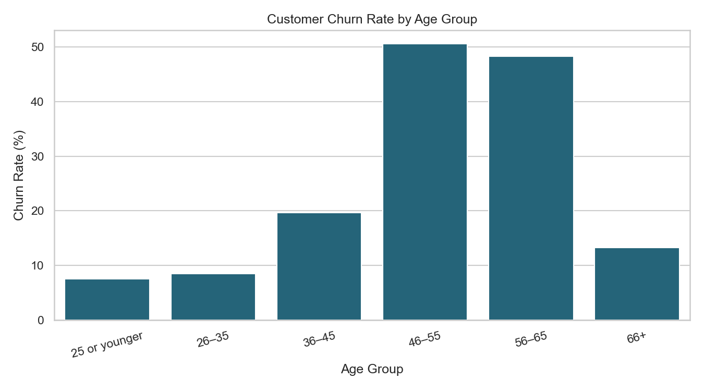
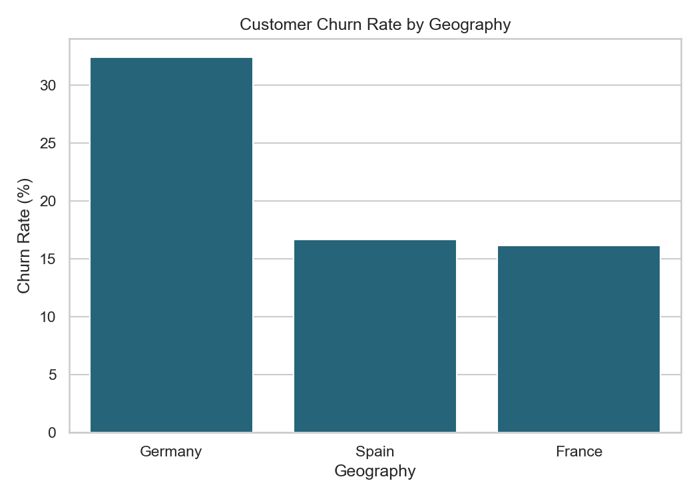

# ChurnIQ — Bank Customer Churn Prediction

## Overview

ChurnIQ is a machine learning project that predicts whether a bank customer is likely to leave the bank. It uses customer information to identify patterns associated with churn and presents predictions through an interactive Streamlit web application.

## Problem Statement

Customer churn can affect a bank's customer retention and long-term business performance. Identifying customers who may leave can help banks investigate potential issues and develop suitable retention strategies.

## Objectives

- Explore customer data and identify patterns associated with churn.
- Preprocess numerical and categorical features.
- Train and compare machine learning models.
- Evaluate model performance using classification metrics.
- Build an interactive web application for churn prediction.

## Dataset

The project uses the **Churn Modelling** dataset, containing 10,000 customer records and 14 columns.

- **Target variable:** `Exited`
- `0` — Customer stayed
- `1` — Customer exited

The dataset includes customer attributes such as credit score, geography, age, tenure, account balance, number of products, activity status and estimated salary.

Identifiers such as `RowNumber`, `CustomerId` and `Surname` are excluded from model training.

## Exploratory Data Analysis (EDA)

The dataset contains 10,000 records and has no missing values.

### 1. Customer Churn Distribution



- Customers who stayed: 7,963 (79.63%)
- Customers who exited: 2,037 (20.37%)

The target classes are imbalanced, so accuracy alone is not sufficient to evaluate the model.

### 2. Churn Rate by Age Group



The 46–55 age group has the highest observed churn rate in this dataset, followed by the 56–65 age group.

### 3. Churn Rate by Geography



Germany has a higher observed churn rate than France and Spain in this dataset. These results show associations and do not establish causation.

## Machine Learning Models

The project compares two classification models:

1. Logistic Regression
2. Random Forest Classifier

The preprocessing pipeline handles categorical features using one-hot encoding and scales numerical features. The data is split into training and testing sets using an 80:20 ratio with stratification.

## Model Evaluation

The Random Forest model achieved the following results on the test set:

| Metric | Score |
|---|---:|
| Accuracy | 85.90% |
| Churn precision | 76.60% |
| Churn recall | 44.23% |
| Churn F1-score | 56.07% |

Recall is particularly important because missed churners may represent customers the bank could otherwise investigate for retention.

## Interactive Web Application

The project includes a Streamlit application that allows users to enter customer details and receive a churn prediction with an estimated probability. It also displays model evaluation, feature importance and model comparison results.

## Technologies Used

- Python
- Pandas and NumPy
- Scikit-learn
- Matplotlib and Seaborn
- Streamlit
- Joblib

## Running the Project

 
## Running the Project

### 1. Install dependencies

```bash
pip install -r requirements.txt
```

### 2. Generate EDA visualizations

```bash
python eda.py
```

### 3. Train the model

```bash
python train_model.py
```

This generates `churn_model.joblib` and `classification_report.txt`.

### 4. Compare models

```bash
python compare_models.py
```

This generates `model_comparison.csv`.

### 5. Launch the application

```bash
streamlit run app.py
```

Ensure `data/Churn_Modelling.csv` is present before running the scripts.


## Limitations

- The model's churn recall indicates that some actual churners are missed.
- Predictions reflect patterns in the available dataset and are not guarantees of future customer behavior.
- Feature importance indicates model reliance, not causation.

## Future Improvements

- Improve recall for the churn class.
- Evaluate additional classification models and decision thresholds.
- Add further customer-segment analysis.
- Explore deployment options for the Streamlit application.